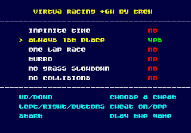
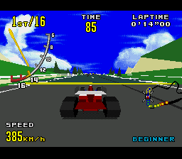
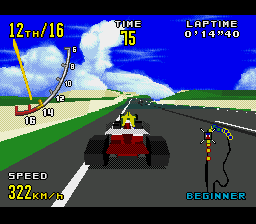
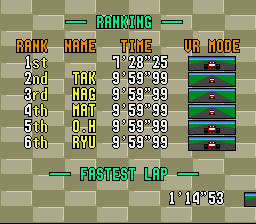

# Virtua Racing +6H by TREX

A ROM hack of **Virtua Racing (USA)** for the Sega Mega Drive / Genesis that adds:

- a **+6 trainer menu** at power-on, and
- **battery-saved records**: course rankings, fastest laps and best-lap times now survive switching off.



## The cheats

The menu shows `VIRTUA RACING +6H BY TREX` at power-on and on Reset. Up/Down picks a cheat, Left/Right or any button (A, B, C, X, Y, Z) turns it on or off, and Start runs the game. Every cheat starts off.

| Cheat | What it does |
| --- | --- |
| INFINITE TIME | The race clock stops counting down. Checkpoints still add time, up to 99. |
| ALWAYS 1ST PLACE | You are always 1st in the race order, so you finish 1st. |
| ONE LAP RACE | The race ends after one lap. |
| TURBO | A stronger engine and a higher rev limit: about 390 km/h instead of 330. |
| NO GRASS SLOWDOWN | Wheels on grass or sand don't slow the car down. Walls and signs still stop you. |
| NO COLLISIONS | You drive straight through rival cars. |

All three courses can already be picked from the start in the original game, so there is no "unlock all courses" cheat.

| Turbo + always 1st | No collisions |
| --- | --- |
|  |  |

## High score saving

Records are kept in 8 KB of battery SRAM at `$200001-$203FFF` (odd bytes), stored twice with a checksum so a power cut mid-save loses at most the newest record. Records set with cheats on are saved like any other.



**MiSTer: saving needs the TREX fork of the MiSTer Mega Drive core.** The stock MiSTer MegaDrive core disables SRAM saving on SVP cartridges (it reuses the save RAM as the SVP chip's DRAM), so on the original core the game runs but records are never saved. The TREX core gives SVP games their own save RAM; Virtua Racing +6H saves correctly on MiSTer with TREX core v3.

Emulators that support both the SVP chip and an SRAM header work too: Genesis Plus GX and PicoDrive were tested (RetroArch on PC writes the `.srm`). BlastEm does not emulate the SVP. An original cartridge has no SRAM, so real hardware needs a flash cart that runs SVP games and gives them SRAM.

## Patching

No ROM is included. Apply a patch from [`patches/`](patches/) to your own copy of **Virtua Racing (USA)** with [Flips](https://github.com/Alcaro/Flips), [Rom Patcher JS](https://www.marcrobledo.com/RomPatcher.js/) or any IPS/BPS patcher.

| Input ROM | |
| --- | --- |
| `Virtua Racing (U).bin` | 2,097,152 bytes, CRC32 `7E1A324A` |

| Patch | Result | Result CRC32 |
| --- | --- | --- |
| `Virtua Racing (U) [SRAM] [T+6].bps` / `.ips` | Trainer + saving (the full hack) | `BB24CE3F` |
| `Virtua Racing (U) [SRAM].bps` / `.ips` | Saving only, no trainer | `2D7EFF2F` |

The BPS patches check the input ROM's CRC; the IPS patches don't, so check your ROM first.

## Building from source

Needs GNU binutils for m68k (`binutils-m68k-linux-gnu`) and Python 3.

```sh
cd sram && sh build.sh "/path/to/Virtua Racing (U).bin"   # -> sram/Virtua Racing (U) [SRAM].bin
cd ../trainer && sh build.sh                             # -> trainer/Virtua Racing (U) [SRAM] [T+6].bin
python3 tools/mkpatch.py "Virtua Racing (U).bin" "trainer/Virtua Racing (U) [SRAM] [T+6].bin" out  # out.ips, out.bps
```

`patch.py` in each folder checks the input ROM's CRC and the original bytes at every hook before patching, then fixes the header checksum. Details of how each part works are in [`sram/README.md`](sram/README.md) and [`trainer/README.md`](trainer/README.md). `trainer/test-tools/` has the headless Genesis Plus GX test harness and autopilot used to test the cheats.

Virtua Racing is © Sega. This repository contains only original patch code and patches, no Sega ROM data.
